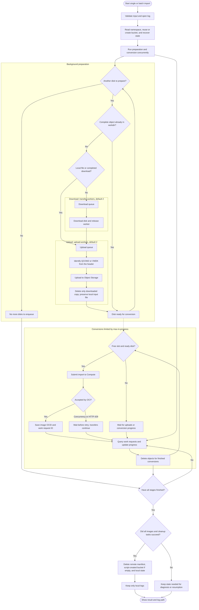
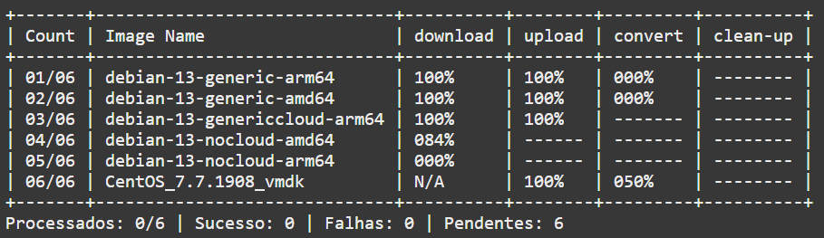
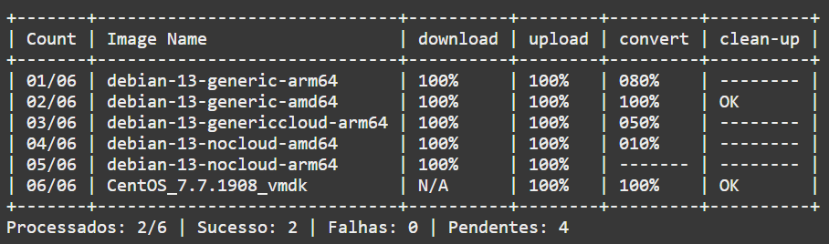
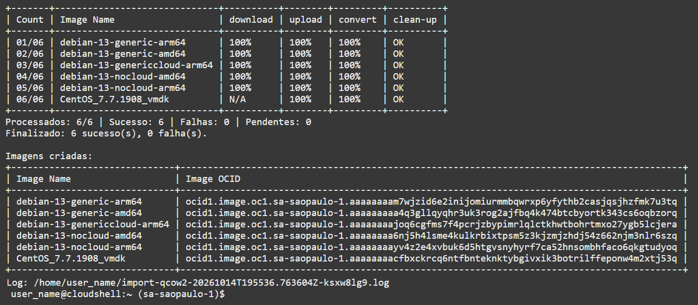

# QCOW2 and VMDK disk import to OCI

[](https://www.python.org/)
[](https://docs.oracle.com/en-us/iaas/Content/API/SDKDocs/cliinstall.htm)

**English (en-US)** · [Português (pt-BR)](README.pt-BR.md) · [All scripts](../README.md)

Automates importing QCOW2 and VMDK disks as custom images in Oracle Cloud Infrastructure (OCI). Accepts HTTP/HTTPS URLs or local files, uploads disks to Object Storage, submits and monitors imports, and provides per-image progress, resumable execution, and automatic cleanup. Supports a single image through command-line arguments or a batch defined in JSON.

## Disclaimer

This script is provided as is, without warranties concerning availability, security, image compatibility, or suitability for a particular environment. No support, maintenance, updates, or service-level commitments are provided.

Execution uses the permissions of the configured OCI account, may incur storage and transfer charges, and deletes temporary files and resources according to the cleanup workflow described below. Before running it, verify source URLs, region, compartments, permissions, and backups, and validate both the images and the tool's behavior before using it in production.

Users are responsible for their use and modification of this material. To the extent permitted by applicable law, authors and contributors accept no liability for data loss, charges, unavailability, or other damage resulting from use of the script. References to Oracle and OCI do not imply endorsement, certification, or a warranty from Oracle.

## Requirements and quick start

Run commands from the directory containing the script. It does not automatically install or configure OCI CLI.

| Component | Requirement |
| --- | --- |
| System | Linux or OCI Cloud Shell, with a terminal for viewing progress |
| Python | 3.10 or later |
| Python libraries | Standard library only; no packages to install with pip |
| OCI CLI | Installed and authenticated for the destination tenancy and region |
| Permissions | Read the namespace; create and inspect images and work requests; read and write objects; delete the objects used; create and delete the bucket when necessary |
| Network | Access to source URLs and OCI APIs; HTTPS sources normally require outbound TCP/443 |
| Local space | Enough for active downloads and disks waiting for upload; downloaded copies are removed after upload |

No external Python modules are required. Generate example input:

```bash
python3 import-qcow2-disk-to-oci.py --create-example images.json
```

Edit the URLs, compartments, and names in the JSON file, then run:

```bash
python3 import-qcow2-disk-to-oci.py --batch-file images.json
```

The example generator does not overwrite existing files. A [sample batch file](exemplo-import.json) is also included.

## Import modes

The mode is implicit: `--batch-file` selects batch mode, and `--source` selects single mode. Both monitor all conversions and cleanup tasks before a normal exit. The disk header identifies `QCOW2` or `VMDK`, and the script sends that type to OCI with the `PARAVIRTUALIZED` launch mode. No local format conversion is performed.

### Single image import

Provide a URL or local path, the compartment OCID, and the image name:

```bash
python3 import-qcow2-disk-to-oci.py \
  --source https://example.com/debian-13.qcow2 \
  --compartment-id ocid1.compartment.oc1..replace_with_your_ocid \
  --image-name custom-image-debian-13
```

### Batch import

The JSON file must contain an `images` list. All entries are validated before any OCI operation:

```json
{
  "images": [
    {
      "source": "https://example.com/debian-13.qcow2",
      "compartment_id": "ocid1.compartment.oc1..replace_with_your_ocid",
      "image_name": "custom-image-debian-13"
    },
    {
      "source": "./disks/server.vmdk",
      "compartment_id": "ocid1.compartment.oc1..another_compartment",
      "image_name": "server-vmdk"
    }
  ]
}
```

The example combines a QCOW2 URL with a local VMDK; adjust the path to an existing file. Each entry requires exactly `source`, `compartment_id`, and `image_name`. `source` accepts a URL or local path. Use valid JSON without comments or trailing commas. YAML input from earlier versions must be converted to JSON; field names remain unchanged. Remote sources must use HTTP or HTTPS. Identical entries are rejected. A batch can target different compartments.

```bash
python3 import-qcow2-disk-to-oci.py --batch-file images.json
```

### Local sources and supported formats

To upload a previously converted local disk:

```bash
python3 import-qcow2-disk-to-oci.py \
  --source ./disks/server.vmdk \
  --compartment-id ocid1.compartment.oc1..replace_with_your_ocid \
  --image-name server-vmdk
```

In single mode, relative paths use the directory from which the script was started. In batch JSON, relative paths use the directory containing the batch file. `~` expands to the user's home directory. The input must exist, be a readable regular file, and remain unchanged throughout upload and resumption.

The script identifies QCOW2 and VMDK from their headers, regardless of extension. This identifies the format; it does not replace OCI's integrity and compatibility checks. VMDK must be a complete, monolithic disk of type `monolithicSparse` or `streamOptimized`. Separate descriptors and split disks are unsupported. Prepare VDI, VHD, VHDX, RAW, and OVA/OVF packages externally as QCOW2 or VMDK before using the script. Running this script does not require installing `qemu-img`.

Local files are read directly without a staging copy. Download shows `N/A` in the table. State and logs record the source and detected format, and the original file is preserved after every stage. Resuming a multipart upload requires the same unchanged local file to remain available.

Downloads and uploads have independent queues and workers. Local files and completed downloads from resumed executions enter the upload queue directly, with local files prioritized; pending URLs enter the download queue. Each completed download releases its worker and enters the upload queue. The table keeps JSON input order. By default, two downloads and two uploads can run simultaneously. After upload, conversion is submitted as soon as a `--max-in-progress` slot is available, without waiting for other transfers.

### Arguments

| Argument | Purpose | Default |
| --- | --- | --- |
| `--batch-file FILE.json` | Import the images defined in JSON | — |
| `--source URL_OR_FILE` | Import a URL or local file; requires a compartment and name | — |
| `--compartment-id OCID` | Compartment for single mode | — |
| `--image-name NAME` | Image name for single mode | — |
| `--max-in-progress N` | Concurrent conversion limit for this execution | `3` |
| `--transfer-workers N` | Concurrent downloads | `2` |
| `--upload-workers N` | Concurrent uploads, independent of downloads | `2` |
| `--create-example FILE.json` | Create example batch input and exit | — |
| `--check-status STATE.json` | Query conversions from an existing local state file | — |
| `--help` | Show command-line help | — |

Working paths and polling/retry intervals are automatic. You can omit concurrency arguments to use the defaults. To override them:

```bash
python3 import-qcow2-disk-to-oci.py --batch-file images.json \
  --max-in-progress 5 --transfer-workers 4 --upload-workers 2
```

## How-to: convert disks to QCOW2

Conversion is an external preparation step using `qemu-img`. This tool is only needed to convert the disk; the importer still requires only Python's standard library and OCI CLI.

### 1. Prepare the environment

Shut down the source VM and use a consistent copy of the disk, with any required base files and snapshots available. Reserve space for both input and output. Choose a new output path, different from the input and any existing file. See [QEMU's guidance on offline images](https://www.qemu.org/docs/master/tools/qemu-img.html).

Install the tool on the machine used for conversion, according to its distribution:

```bash
# Debian / Ubuntu
sudo apt update
sudo apt install qemu-utils

# Fedora (alternative)
sudo dnf install qemu-img
```

Package references: [Debian qemu-utils](https://packages.debian.org/stable/qemu-utils) and [Fedora qemu-img](https://packages.fedoraproject.org/pkgs/qemu/qemu-img/). You do not need to run both installation methods.

#### Alternative: download the binary without installing packages

In environments without package manager access, such as OCI Cloud Shell, you can use a static build in your home directory without `sudo`. The [hermeticbuild/qemu-prebuilt](https://github.com/hermeticbuild/qemu-prebuilt) project publishes Linux AMD64 and ARM64 binaries. This is a third-party distribution, independent of the QEMU project and Oracle.

This example pins [version 11.0.0.1](https://github.com/hermeticbuild/qemu-prebuilt/releases/tag/11.0.0.1), detects the architecture of the machine performing the conversion, and checks the checksum before extraction:

```bash
(
  set -e

  case "$(uname -m)" in
    x86_64) qemu_arch=amd64 ;;
    aarch64) qemu_arch=arm64 ;;
    *) echo "Unsupported architecture / Arquitetura não contemplada"; exit 1 ;;
  esac

  qemu_version=11.0.0.1
  qemu_archive="qemu-img-linux-${qemu_arch}-${qemu_version}.tar.gz"
  qemu_base="https://github.com/hermeticbuild/qemu-prebuilt/releases/download/${qemu_version}"
  qemu_dir="$HOME/.local/opt/qemu-img/${qemu_version}/$(uname -m)"

  mkdir -p "$qemu_dir"
  cd "$qemu_dir"

  curl -fLO "$qemu_base/$qemu_archive"
  curl -fLO "$qemu_base/$qemu_archive.sha256"
  sha256sum -c "$qemu_archive.sha256"

  tar -xzf "$qemu_archive"
  ./bin/qemu-img --version
)
```

After confirming that the command above succeeded, add the directory to the current session's `PATH`:

```bash
export PATH="$HOME/.local/opt/qemu-img/11.0.0.1/$(uname -m)/bin:$PATH"
qemu-img --version
```

Repeat the `export` in new sessions. The binary architecture must match Cloud Shell, regardless of the architecture of the disk being converted. The checksum verifies download integrity against the file published by the same provider; it does not replace assessing provenance. This project has not validated this binary on OCI Cloud Shell.

Downloading requires internet access. In the tenancy's home region, Cloud Shell provides 5 GB of persistent home storage; outside it, with regional launch, the home directory is ephemeral. Both input and output must fit in the available space. For larger disks, convert on another machine. See [Cloud Shell features and limitations](https://docs.oracle.com/en-us/iaas/Content/API/Concepts/cloudshellintro.htm).

### 2. Identify and convert the disk

VMDK example, run from the importer directory:

```bash
qemu-img info --backing-chain ./disks/server.vmdk
qemu-img convert -p -f vmdk -O qcow2 ./disks/server.vmdk ./disks/server.qcow2
```

`-p` shows progress, `-f` specifies the input format, and `-O qcow2` selects the output format. Confirm the format with `info`; the extension alone does not determine it. Other examples:

| Source | Command |
| --- | --- |
| VirtualBox VDI | `qemu-img convert -p -f vdi -O qcow2 ./disks/source.vdi ./disks/output-vdi.qcow2` |
| Hyper-V VHD | `qemu-img convert -p -f vpc -O qcow2 ./disks/source.vhd ./disks/output-vhd.qcow2` |
| Hyper-V VHDX | `qemu-img convert -p -f vhdx -O qcow2 ./disks/source.vhdx ./disks/output-vhdx.qcow2` |
| RAW | `qemu-img convert -p -f raw -O qcow2 ./disks/source.raw ./disks/output-raw.qcow2` |

[QEMU disk formats](https://www.qemu.org/docs/master/system/images.html) use `vpc` as the format name for VHD. For split VMDK, use the descriptor referencing the extents and keep them together. With snapshots, identify the desired state and keep the entire chain accessible. OVA/OVF requires extracting or locating the boot disk before conversion. An installation ISO is not an installed system disk.

### 3. Validate the result

```bash
qemu-img info ./disks/server.qcow2
qemu-img check -f qcow2 ./disks/server.qcow2
qemu-img compare -p -f vmdk -F qcow2 ./disks/server.vmdk ./disks/server.qcow2
```

Confirm `file format: qcow2`, the expected virtual size, and no `backing file` in the output. `check` verifies structure; `compare` checks logical content between input and output and may take time. Both must exit with code zero. Adjust the input format and paths when comparing other sources. See the [command documentation](https://www.qemu.org/docs/master/tools/qemu-img.html).

Format conversion does not change architecture, firmware, drivers, or operating system configuration. Before importing, review OCI requirements for [Linux](https://docs.oracle.com/en-us/iaas/Content/Compute/Tasks/importingcustomimagelinux.htm) or [Windows](https://docs.oracle.com/en-us/iaas/Content/Compute/Tasks/importingcustomimagewindows.htm). These checks do not guarantee that the system will boot on OCI.

### 4. Import the local QCOW2

```bash
python3 import-qcow2-disk-to-oci.py \
  --source ./disks/server.qcow2 \
  --compartment-id ocid1.compartment.oc1..replace_with_your_ocid \
  --image-name server-qcow2
```

For batches, put the QCOW2 path in the JSON `source` field. The importer preserves the local disk; retain the original until you validate the image and instance boot.

## Workflow



The two download workers and two upload workers are independent: uploads do not occupy download slots, and local files do not wait for downloads. Both queues continue even when all conversion slots are occupied. If downloads are faster than uploads, completed disks may accumulate locally until uploaded; account for that space when sizing a batch. The upload limit counts disks, not parallel parts of an OCI CLI multipart upload.

Accepted conversions are monitored until they reach a terminal state. Successful conversions also require the image to be `AVAILABLE` before deleting its source object. An uncertain submission result stops execution for reconciliation, avoiding an automatic resubmission that could create a duplicate image.

## Terminal progress

**Downloads, uploads, and conversions running concurrently:**



**Conversions finishing and source objects being cleaned up:**



**Completed execution with image names, OCIDs, and log location:**



The table refreshes on changes at one-second intervals; conversion polling uses an internal 30-second interval. Interactive terminals redraw the table. Redirected output receives snapshots without ANSI escape sequences. Runtime messages remain in Portuguese; the summary above means processed, successful, failed, and pending images.

- `Count` shows position/total in input order; single mode displays `01/01`.
- `Image Name` fits the longest input name, with a minimum width for its header.
- `N/A` in download identifies a local source, which needs no download. Dashes fill the column, leaving one space at each end, to indicate a stage has not started; `RUN` means active without an available percentage; `ERR` means failed.
- Downloads use received bytes and `Content-Length`, when available. Uploads use the OCI CLI percentage and reach `100%` only after the command succeeds. Conversion progress comes from the work request's `percent-complete` field.
- Cleanup displays `cleaning` while running and `OK` when finished; dashes mean not started and `ERR` indicates failure. A converted image is still pending until cleanup finishes; transfer failures count as processed attempts with an error.

On exit, the script prints an `Image Name` / `Image OCID` table for successfully converted images, including those with a subsequent cleanup failure. Failed or still processing imports are excluded. Image OCIDs also remain in the log file.

## Bucket and working directories

The bucket name is fixed: **`custom_image`**. An existing bucket in the execution region is reused; otherwise, it is created in the first entry's compartment. Each image is created in its own configured compartment, even if the bucket belongs to a different one.

Each input set receives a deterministic identifier, independent of JSON entry order:

```text
During execution, in the current directory:
  .oci-import/IDENTIFIER/state.json
  .oci-import/IDENTIFIER/state.json.lock
  .oci-import/IDENTIFIER/IMAGE_KEY.disk
  import-qcow2-UTC_TIMESTAMP-UNIQUE_IDENTIFIER.log

Object Storage:
  custom_image/
    qcow2-import/IDENTIFIER/
      state.json
      IMAGE_KEY.disk
```

The bucket folder is an object prefix. The remote manifest and local state record stages and IDs. Local state is written atomically, and relevant checkpoints are also uploaded to the bucket.

## Resuming and automatic cleanup

To resume, repeat the command with the same sources, compartments, names, profile, region, and working directory. Preserve `.oci-import` and the bucket workdir. The script reuses complete objects and monitors registered conversions. The remote manifest allows recovery even without local state.

Before preparing disks and immediately before submitting an import, the script looks for processing images with the same name in the compartment. The `qcow2-import-key` tag confirms the input identity, even when the batch list has changed. With one confirmed candidate, it recovers the image OCID and work request without submitting another conversion. An available image can also be recovered when the state or workdir object provides evidence of an interrupted execution. Multiple candidates, or a same-name import whose source cannot be confirmed, stop execution and report OCIDs for reconciliation. The script does not automatically select or delete duplicate images. [Listing work requests by resource](https://docs.oracle.com/en-us/iaas/tools/oci-cli/latest/oci_cli_docs/cmdref/work-requests/work-request/list.html) requires read permission.

Partial downloads resume by byte offset using `Range` and `If-Range`, with a strong ETag or Last-Modified to validate the source. Metadata is stored in a `.disk.http.json` file beside the downloaded copy. A `206` response must provide a valid range and size; a full `200` response replaces the partial file when Range is ignored or the source changes. A `416` response confirms an already complete file only when size and validator match; otherwise, downloading restarts. See [HTTP range semantics](https://www.rfc-editor.org/rfc/rfc9110.html#section-14).

Without a trusted validator or local metadata, including partial files from older versions, downloads restart for safety. Inconsistent partial responses stop the transfer and preserve the existing file. The log records resumption, byte offsets, or restart reasons. Metadata is deleted with the downloaded copy after upload.

Multipart uploads can resume when both the upload ID and complete local disk are available; otherwise, the known incomplete upload is aborted before downloading again.

Run only one instance per workdir. The local lock prevents two processes from using the same state file; different hosts do not share that lock.

| Resource | Cleanup behavior |
| --- | --- |
| Copy downloaded from a URL | Deleted immediately after upload |
| Local input file provided through `source` | Preserved on success, failure, and resumption |
| QCOW2 or VMDK object in the bucket | Deleted after conversion finishes, including failures; successful conversions require an `AVAILABLE` image |
| Remote manifest | Deleted after the stages finish; retained on interruptions or transfer failures |
| Preexisting bucket | Preserved |
| Bucket created by the script | Deleted if empty and without pending multipart uploads |
| Local state, lock, and directories | Removed after complete success; files needed for recovery remain on failures or interruptions |
| Logs | Kept in the execution directory; older logs inside the workdir are moved out before cleanup |

Cleanup never deletes the original local input file. It does not delete Compute custom images or empty buckets to remove other executions' objects. `.oci-import` is removed only when empty. After complete success, only the generated logs remain locally.

**Repeating the command after successful completion and cleanup starts a new import**, because completion state has been removed. Previous IDs remain in the log.

## Logs and post-execution validation

Each execution creates its own file in the directory from which the script was started:

```text
./import-qcow2-UTC_TIMESTAMP-UNIQUE_IDENTIFIER.log
```

The path is displayed once on completion or interruption. Resuming creates a separate log and preserves earlier ones. Each line contains a JSON event with a UTC timestamp; image events include `image_name` and `image_key`.

The log records stage starts and completions, downloaded sizes, IDs, resumption decisions, waits for conversion slots, retries, errors, namespace/bucket/workdir operations, checkpoints, and local/remote cleanup. The final event includes duration, result, and OCI command invocation counts. Percentages and polls without status changes do not generate repeated entries. Writes are synchronized across workers, with a flush after each event.

```bash
cat import-qcow2-FILE.log
oci work-requests work-request get --work-request-id WORK_REQUEST_OCID
```

While a pending or failed execution still has local state:

```bash
python3 import-qcow2-disk-to-oci.py \
  --check-status .oci-import/IDENTIFIER/state.json
```

Exit codes: `0` when all images succeed; `1` on failure; `2` for invalid command-line usage; `130` for keyboard interruption.

## Limits and troubleshooting

The default of three conversions is an operational choice made by the script, not a confirmed OCI public cloud limit. It counts only this execution; imports started through the Console or other tools can occupy capacity outside that count.

HTTP 429 and HTTP 409 responses indicating concurrency/capacity limits receive retries with increasing delays. Rejected submissions have an internal retry deadline of 7200 seconds; that deadline does not limit the duration of an accepted conversion. HTTP 400 `LimitExceeded` or `QuotaExceeded` is recorded as a quota failure; increasing concurrency does not resolve it.

Check **Limits, Quotas and Usage** for your tenancy's effective limits. The published limit of ten concurrent imports for **Compute Cloud@Customer** applies to that product and should not automatically be applied to OCI public cloud. The `custom-image-count` quota counts regional images, not concurrent conversions.

OCI CLI object listings may return `data` as a list, or only `{"prefixes": []}` when empty. The script normalizes these shapes and also accepts `data.objects`. An unknown structure stops execution rather than treating an unknown bucket as empty.

Current state uses JSON version 3. The old `--qcow2` argument has been removed, and the batch field `url` has been replaced by `source`. States from older versions are not resumed by this version; finish pending executions with the previous version and check their IDs before resubmitting images.

## Tests

```bash
python3 -m unittest discover -s tests -v
```

Tests cover concurrency, OCI CLI responses, progress, recovery, logs, and cleanup. They simulate OCI and do not create cloud resources.

## References

- [OCI CLI installation](https://docs.oracle.com/en-us/iaas/Content/API/SDKDocs/cliinstall.htm)
- [Limits by service](https://docs.oracle.com/en-us/iaas/Content/General/service-limits/default.htm)
- [Compute Cloud@Customer concurrency](https://docs.oracle.com/en-us/iaas/compute-cloud-at-customer/ccc/limits-on-concurrent-operations.htm)
- [Linux image and VMDK requirements](https://docs.oracle.com/en-us/iaas/Content/Compute/Tasks/importingcustomimagelinux.htm)
- [API errors](https://docs.oracle.com/en-us/iaas/Content/API/References/apierrors.htm)
- [Work requests](https://docs.oracle.com/en-us/iaas/Content/General/Concepts/workrequestoverview.htm)
- [Resuming multipart uploads](https://docs.oracle.com/en-us/iaas/tools/oci-cli/latest/oci_cli_docs/cmdref/os/object/resume-put.html)
- [OCI CLI object_list implementation](https://github.com/oracle/oci-cli/blob/master/services/object_storage/src/oci_cli_object_storage/objectstorage_cli_extended.py)
