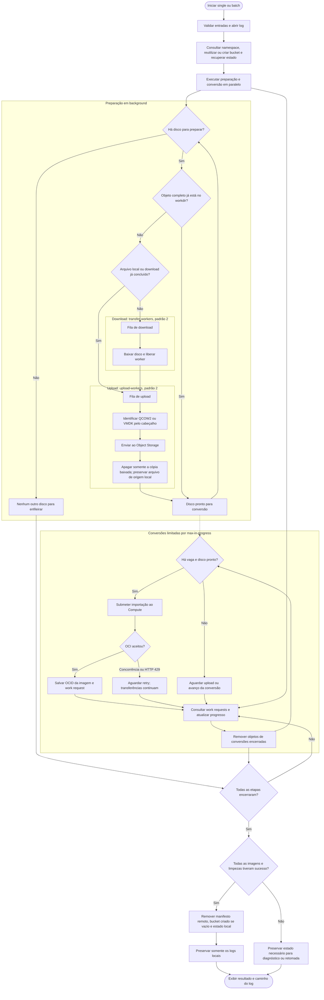

# Importação de discos QCOW2 e VMDK para OCI

[](https://www.python.org/)
[](https://docs.oracle.com/en-us/iaas/Content/API/SDKDocs/cliinstall.htm)

**Português (pt-BR)** · [English (en-US)](README.md) · [Todos os scripts](../README.pt-BR.md)

Automatiza a importação de discos QCOW2 e VMDK como imagens customizadas no Oracle Cloud Infrastructure (OCI). Aceita URLs HTTP/HTTPS ou arquivos locais, faz upload para Object Storage, submete e acompanha a importação, com progresso por imagem, retomada e limpeza automática. Suporta uma imagem por parâmetros ou um lote em JSON.

## Aviso legal

Este script é fornecido como está, sem garantias de disponibilidade, segurança, compatibilidade das imagens ou adequação a um ambiente específico. Não há compromisso de suporte, manutenção, atualização ou nível de serviço.

A execução usa as permissões da conta OCI configurada, pode gerar custos de armazenamento e transferência e remove arquivos e recursos temporários conforme o fluxo de limpeza descrito abaixo. Quem executa o script deve conferir URLs, região, compartments, permissões e backups, além de validar as imagens e o comportamento da ferramenta antes de usá-la em produção.

O uso e as alterações deste material são de responsabilidade de quem os realiza. Na medida permitida pela legislação aplicável, autores e colaboradores não assumem responsabilidade por perda de dados, cobranças, indisponibilidade ou outros danos decorrentes do uso do script. As referências à Oracle e à OCI não implicam endosso, certificação ou garantia por parte da Oracle.

## Requisitos e início rápido

Execute a partir da pasta que contém o script. Ele não instala nem configura o OCI CLI automaticamente.

| Componente | Requisito |
| --- | --- |
| Sistema | Linux ou OCI Cloud Shell, com terminal para acompanhar a tabela |
| Python | 3.10 ou superior |
| Bibliotecas Python | Somente a biblioteca padrão; nenhum pacote para instalar com pip |
| OCI CLI | Instalado e autenticado na tenancy e região de destino |
| Permissões | Consultar namespace; criar e consultar imagens e work requests; consultar e gravar objetos; excluir os objetos usados; criar e excluir o bucket quando necessário |
| Rede | Acesso às URLs de origem e às APIs OCI; fontes HTTPS usam normalmente TCP/443 de saída |
| Espaço local | Suficiente para os downloads ativos e os discos aguardando upload; cópias baixadas são removidas após o upload |

Nenhum módulo Python externo é necessário. Gere um arquivo de exemplo:

```bash
python3 import-qcow2-disk-to-oci.py --create-example imagens.json
```

Edite as URLs, compartments e nomes no JSON e execute:

```bash
python3 import-qcow2-disk-to-oci.py --batch-file imagens.json
```

O gerador de exemplo não sobrescreve arquivos existentes. Há também um [exemplo de lote no repositório](exemplo-import.json).

## Modos de importação

O modo é implícito: `--batch-file` seleciona batch e `--source` seleciona single. Ambos acompanham todas as conversões e tarefas de limpeza antes de encerrar normalmente. O formato `QCOW2` ou `VMDK` é identificado pelo cabeçalho do disco e informado à OCI, com modo de lançamento `PARAVIRTUALIZED`. Não há conversão local de formatos.

### Importação individual

Informe uma URL ou um caminho local, o OCID do compartment e o nome da imagem:

```bash
python3 import-qcow2-disk-to-oci.py \
  --source https://example.com/debian-13.qcow2 \
  --compartment-id ocid1.compartment.oc1..substitua_pelo_ocid \
  --image-name custom-image-debian-13
```

### Importação em lote

O JSON deve conter uma lista `images`. Todas as entradas são validadas antes de qualquer operação na OCI:

```json
{
  "images": [
    {
      "source": "https://example.com/debian-13.qcow2",
      "compartment_id": "ocid1.compartment.oc1..substitua_pelo_ocid",
      "image_name": "custom-image-debian-13"
    },
    {
      "source": "./discos/servidor.vmdk",
      "compartment_id": "ocid1.compartment.oc1..outro_compartment",
      "image_name": "servidor-vmdk"
    }
  ]
}
```

O exemplo mistura uma URL QCOW2 e um VMDK local; ajuste o caminho para um arquivo existente. Cada entrada exige `source`, `compartment_id` e `image_name`, sem campos adicionais. `source` aceita URL ou caminho local. Use JSON válido, sem comentários nem vírgulas finais. Arquivos YAML de versões anteriores devem ser convertidos para JSON; os nomes dos campos permanecem iguais. Origens remotas devem usar HTTP ou HTTPS. Entradas idênticas são rejeitadas. O mesmo lote pode conter imagens destinadas a compartments diferentes.

```bash
python3 import-qcow2-disk-to-oci.py --batch-file imagens.json
```

### Origens locais e formatos aceitos

Para enviar um disco local já convertido:

```bash
python3 import-qcow2-disk-to-oci.py \
  --source ./discos/servidor.vmdk \
  --compartment-id ocid1.compartment.oc1..substitua_pelo_ocid \
  --image-name servidor-vmdk
```

Em single, caminhos relativos usam o diretório de onde o script foi iniciado. No JSON, caminhos relativos usam a pasta do próprio arquivo de lote. `~` é expandido para o diretório do usuário. O arquivo deve existir, ser um arquivo regular legível e permanecer sem alterações durante o envio ou sua retomada.

O script identifica QCOW2 e VMDK pelo cabeçalho, independentemente da extensão. A verificação identifica o formato; ela não substitui a validação de integridade e compatibilidade da OCI. VMDK deve ser um disco completo, monolítico, dos tipos `monolithicSparse` ou `streamOptimized`. Descritores separados e discos divididos não são suportados. VDI, VHD, VHDX, RAW e pacotes OVA/OVF devem ser preparados externamente como QCOW2 ou VMDK antes de usar o script. Não é necessário instalar `qemu-img` para executar este script.

Arquivos locais são lidos diretamente, sem cópia de preparação. O download fica como `N/A` na tabela. O estado e o log registram a origem e o formato identificado; o arquivo original é preservado após todas as etapas. Se um upload multipart precisar ser retomado, o mesmo arquivo local deve estar disponível e sem alterações.

Download e upload têm filas e workers independentes. Arquivos locais e downloads já concluídos na retomada entram diretamente na fila de upload, com prioridade para os locais; URLs pendentes entram na fila de download. Cada download concluído libera seu worker e segue para a fila de upload. A tabela mantém a ordem do JSON. Por padrão, podem ocorrer dois downloads e dois uploads ao mesmo tempo. Após o upload, a conversão é submetida assim que houver uma vaga em `--max-in-progress`, sem aguardar as outras transferências.

### Parâmetros

| Parâmetro | Uso | Padrão |
| --- | --- | --- |
| `--batch-file ARQUIVO.json` | Importar as imagens do JSON | — |
| `--source URL_OU_ARQUIVO` | Importar uma URL ou arquivo local; exige compartment e nome | — |
| `--compartment-id OCID` | Compartment no modo single | — |
| `--image-name NOME` | Nome da imagem no modo single | — |
| `--max-in-progress N` | Limite de conversões simultâneas desta execução | `3` |
| `--transfer-workers N` | Downloads simultâneos | `2` |
| `--upload-workers N` | Uploads simultâneos, independentes dos downloads | `2` |
| `--create-example ARQUIVO.json` | Criar o modelo de lote e encerrar | — |
| `--check-status STATE.json` | Consultar conversões de um estado local existente | — |
| `--help` | Exibir a ajuda | — |

Os caminhos de trabalho e os tempos de consulta/retry são automáticos. Não é necessário passar os limites para usar os valores padrão. Para ajustá-los:

```bash
python3 import-qcow2-disk-to-oci.py --batch-file imagens.json \
  --max-in-progress 5 --transfer-workers 4 --upload-workers 2
```

## How-to: converter discos para QCOW2

A conversão é uma preparação externa, feita com `qemu-img`. Essa ferramenta só é necessária para converter o disco; o importador continua usando apenas a biblioteca padrão do Python e o OCI CLI.

### 1. Preparar o ambiente

Desligue a VM de origem e use uma cópia consistente do disco, com os arquivos de base e snapshots necessários disponíveis. Reserve espaço para manter a origem e a saída. Escolha um caminho de saída novo, diferente da origem e de qualquer arquivo existente. Consulte as [orientações do QEMU para imagens offline](https://www.qemu.org/docs/master/tools/qemu-img.html).

Instale a ferramenta na máquina onde fará a conversão, conforme a distribuição:

```bash
# Debian / Ubuntu
sudo apt update
sudo apt install qemu-utils

# Fedora (alternativa)
sudo dnf install qemu-img
```

Pacotes de referência: [qemu-utils no Debian](https://packages.debian.org/stable/qemu-utils) e [qemu-img no Fedora](https://packages.fedoraproject.org/pkgs/qemu/qemu-img/). Não é necessário executar os dois métodos de instalação.

#### Alternativa: baixar o binário sem instalar pacotes

Em ambientes sem acesso ao gerenciador de pacotes, como o OCI Cloud Shell, é possível usar uma compilação estática no diretório pessoal, sem `sudo`. O projeto [hermeticbuild/qemu-prebuilt](https://github.com/hermeticbuild/qemu-prebuilt) publica binários para Linux AMD64 e ARM64. É uma distribuição de terceiros, independente do projeto QEMU e da Oracle.

O exemplo fixa a [versão 11.0.0.1](https://github.com/hermeticbuild/qemu-prebuilt/releases/tag/11.0.0.1), identifica a arquitetura da máquina que executará a conversão e verifica o checksum antes de extrair:

```bash
(
  set -e

  case "$(uname -m)" in
    x86_64) qemu_arch=amd64 ;;
    aarch64) qemu_arch=arm64 ;;
    *) echo "Unsupported architecture / Arquitetura não contemplada"; exit 1 ;;
  esac

  qemu_version=11.0.0.1
  qemu_archive="qemu-img-linux-${qemu_arch}-${qemu_version}.tar.gz"
  qemu_base="https://github.com/hermeticbuild/qemu-prebuilt/releases/download/${qemu_version}"
  qemu_dir="$HOME/.local/opt/qemu-img/${qemu_version}/$(uname -m)"

  mkdir -p "$qemu_dir"
  cd "$qemu_dir"

  curl -fLO "$qemu_base/$qemu_archive"
  curl -fLO "$qemu_base/$qemu_archive.sha256"
  sha256sum -c "$qemu_archive.sha256"

  tar -xzf "$qemu_archive"
  ./bin/qemu-img --version
)
```

Depois de confirmar que o comando acima terminou com sucesso, adicione o diretório ao `PATH` da sessão:

```bash
export PATH="$HOME/.local/opt/qemu-img/11.0.0.1/$(uname -m)/bin:$PATH"
qemu-img --version
```

Repita o `export` ao abrir uma nova sessão. A arquitetura do binário deve corresponder à do Cloud Shell, independentemente da arquitetura do disco convertido. O checksum verifica a integridade do download em relação ao arquivo publicado pelo mesmo fornecedor; não substitui a avaliação da procedência. Esse binário não foi validado por este projeto no OCI Cloud Shell.

O download requer acesso à internet. Na região principal da tenancy, o Cloud Shell oferece 5 GB persistentes no diretório pessoal; fora dela, com lançamento regional, esse diretório é efêmero. Origem e saída precisam caber no espaço disponível. Para discos maiores, converta em outra máquina. Consulte as [características e limitações do Cloud Shell](https://docs.oracle.com/en-us/iaas/Content/API/Concepts/cloudshellintro.htm).

### 2. Identificar e converter o disco

Exemplo com VMDK, executado no diretório do importador:

```bash
qemu-img info --backing-chain ./discos/servidor.vmdk
qemu-img convert -p -f vmdk -O qcow2 ./discos/servidor.vmdk ./discos/servidor.qcow2
```

`-p` exibe progresso, `-f` informa o formato de origem e `-O qcow2` define a saída. Confirme o formato com `info`; a extensão sozinha não o determina. Outros exemplos:

| Origem | Comando |
| --- | --- |
| VirtualBox VDI | `qemu-img convert -p -f vdi -O qcow2 ./discos/origem.vdi ./discos/saida-vdi.qcow2` |
| Hyper-V VHD | `qemu-img convert -p -f vpc -O qcow2 ./discos/origem.vhd ./discos/saida-vhd.qcow2` |
| Hyper-V VHDX | `qemu-img convert -p -f vhdx -O qcow2 ./discos/origem.vhdx ./discos/saida-vhdx.qcow2` |
| RAW | `qemu-img convert -p -f raw -O qcow2 ./discos/origem.raw ./discos/saida-raw.qcow2` |

Os [formatos de disco do QEMU](https://www.qemu.org/docs/master/system/images.html) usam `vpc` como nome do formato VHD. Para VMDK dividido, use o descritor que referencia os segmentos, mantendo-os juntos. Se houver snapshots, identifique o estado desejado e mantenha toda a cadeia acessível. OVA/OVF exige extrair ou localizar o disco de boot antes da conversão. ISO de instalação não equivale a um disco de sistema instalado.

### 3. Validar o resultado

```bash
qemu-img info ./discos/servidor.qcow2
qemu-img check -f qcow2 ./discos/servidor.qcow2
qemu-img compare -p -f vmdk -F qcow2 ./discos/servidor.vmdk ./discos/servidor.qcow2
```

Confirme `file format: qcow2`, o tamanho virtual esperado e a ausência de `backing file` na saída. `check` verifica a estrutura; `compare` verifica o conteúdo lógico entre origem e destino e pode demorar. Ambos devem terminar com código zero. Adapte o formato e os caminhos ao comparar outras origens. Veja a [documentação dos comandos](https://www.qemu.org/docs/master/tools/qemu-img.html).

Converter o formato não altera arquitetura, firmware, drivers ou configuração do sistema operacional. Antes de importar, confira os requisitos da OCI para [Linux](https://docs.oracle.com/en-us/iaas/Content/Compute/Tasks/importingcustomimagelinux.htm) ou [Windows](https://docs.oracle.com/en-us/iaas/Content/Compute/Tasks/importingcustomimagewindows.htm). As verificações acima não garantem que o sistema inicialize na OCI.

### 4. Importar o QCOW2 local

```bash
python3 import-qcow2-disk-to-oci.py \
  --source ./discos/servidor.qcow2 \
  --compartment-id ocid1.compartment.oc1..substitua_pelo_ocid \
  --image-name servidor-qcow2
```

Para lote, use o caminho do QCOW2 no campo `source` do JSON. O importador preserva o disco local; mantenha a origem até validar a imagem e a inicialização da instância.

## Fluxo de funcionamento



Os dois workers de download e os dois workers de upload são independentes: uploads não ocupam vagas de download e arquivos locais não aguardam downloads. Ambas as filas continuam mesmo quando todas as vagas de conversão estão ocupadas. Se downloads forem mais rápidos que uploads, discos concluídos podem se acumular localmente até serem enviados; considere esse espaço ao dimensionar o lote. O limite de upload conta discos, não as partes paralelas de um upload multipart do OCI CLI.

Uma conversão aceita é acompanhada até um estado terminal. Em sucesso, a imagem também precisa estar `AVAILABLE` para que o objeto de origem seja removido. Uma submissão de resultado incerto interrompe a execução para reconciliação, evitando um reenvio automático que poderia duplicar a imagem.

## Progresso no terminal

```text
+-------+------------------------+----------+--------+---------+----------+
| Count | Image Name             | download | upload | convert | clean-up |
+-------+------------------------+----------+--------+---------+----------+
| 01/03 | custom-image-debian-13 | 100%     | 098%   | ------- | -------- |
| 02/03 | custom-image-debian-12 | 053%     | ------ | ------- | -------- |
| 03/03 | custom-image-debian-11 | 100%     | 100%   | 033%    | -------- |
+-------+------------------------+----------+--------+---------+----------+
Processados: 0/3 | Sucesso: 0 | Falhas: 0 | Pendentes: 3
```

A tabela atualiza quando há mudanças, em intervalos de um segundo; consultas de conversão usam um intervalo interno de 30 segundos. Em terminal interativo, a tabela é redesenhada; em saída redirecionada, são emitidos snapshots sem sequências ANSI.

- `Count` mostra posição/total na ordem da entrada; em single, `01/01`.
- `Image Name` acompanha o maior nome da entrada, com largura mínima para o cabeçalho.
- `N/A` em download identifica uma origem local, que não precisa ser baixada. Traços preenchem a coluna, com um espaço em cada extremidade, para indicar etapa não iniciada; `RUN`, atividade sem percentual disponível; `ERR`, falha.
- Download usa bytes recebidos e `Content-Length`, quando disponível. Upload usa o percentual do OCI CLI e só marca `100%` após o comando concluir. Conversão usa `percent-complete` do work request.
- Limpeza mostra `cleaning` durante a execução e `OK` ao terminar; traços indicam que ainda não começou e `ERR` indica falha. Uma imagem convertida ainda é pendente enquanto sua limpeza não terminou; falhas de transferência contam como tentativas processadas com falha.

Ao terminar, o script exibe uma tabela com `Image Name` e `Image OCID` das imagens convertidas com sucesso, inclusive se houver falha posterior na limpeza. Importações com falha ou ainda em processamento não aparecem nessa tabela. Os OCIDs também permanecem no arquivo de log.

## Bucket e diretórios de trabalho

O bucket tem nome fixo **`custom_image`**. Se existir na região de execução, será reutilizado; caso contrário, será criado no compartment da primeira entrada. Cada imagem vai para o compartment definido em sua entrada, mesmo se o bucket estiver em outro compartment.

Cada conjunto de entradas recebe um identificador determinístico, independente da ordem do JSON:

```text
Durante a execução, no diretório atual:
  .oci-import/IDENTIFICADOR/state.json
  .oci-import/IDENTIFICADOR/state.json.lock
  .oci-import/IDENTIFICADOR/CHAVE_DA_IMAGEM.disk
  import-qcow2-DATA_UTC-IDENTIFICADOR_UNICO.log

Object Storage:
  custom_image/
    qcow2-import/IDENTIFICADOR/
      state.json
      CHAVE_DA_IMAGEM.disk
```

A pasta no bucket é um prefixo de objetos. O manifesto remoto e o estado local registram etapas e IDs. O estado local é gravado atomicamente; checkpoints relevantes também são enviados ao bucket.

## Retomada e limpeza automática

Para retomar, repita o comando com as mesmas origens, compartments, nomes, perfil, região e diretório de execução. Preserve `.oci-import` e o workdir do bucket. O script reutiliza objetos completos e acompanha conversões já registradas. O manifesto remoto permite recuperação mesmo sem o estado local.

Antes de preparar os discos e imediatamente antes de submeter uma importação, o script procura imagens em processamento no compartment com o mesmo nome. A tag `qcow2-import-key` confirma a identidade da entrada, inclusive quando a lista do lote mudou. Se houver uma única candidata confirmada, recupera o OCID e o work request, sem submeter outra conversão. Uma imagem já disponível também pode ser recuperada quando há evidência de execução interrompida no estado ou no objeto do workdir. Se houver várias candidatas, ou uma importação de mesmo nome cuja origem não possa ser confirmada, a execução para e informa os OCIDs para reconciliação. O script não escolhe nem exclui automaticamente imagens duplicadas. A [consulta de work requests por recurso](https://docs.oracle.com/en-us/iaas/tools/oci-cli/latest/oci_cli_docs/cmdref/work-requests/work-request/list.html) exige permissão de leitura.

Downloads parciais são retomados por bytes com `Range` e `If-Range`, usando ETag forte ou Last-Modified para verificar a origem. Os metadados ficam em um arquivo `.disk.http.json` ao lado da cópia baixada. Respostas `206` precisam informar um intervalo e tamanho válidos; respostas completas `200` substituem o parcial quando o servidor ignora Range ou a origem muda. Uma resposta `416` só confirma que o arquivo já está completo se tamanho e validador coincidirem; caso contrário, o download reinicia. Veja a [semântica HTTP de intervalos](https://www.rfc-editor.org/rfc/rfc9110.html#section-14).

Sem validador confiável, sem metadados locais ou com arquivos parciais de versões anteriores, o download reinicia por segurança. Respostas parciais inconsistentes interrompem a transferência e preservam o arquivo existente. O log registra a retomada, o offset ou o motivo do reinício. Os metadados são removidos junto com a cópia baixada após o upload.

Uploads multipart podem ser retomados quando o ID e o disco local completo estiverem disponíveis; caso contrário, o upload incompleto conhecido é abortado antes de baixar novamente.

Execute somente uma instância por workdir. A trava local impede dois processos usando o mesmo arquivo de estado; hosts diferentes não compartilham essa trava.

| Recurso | Limpeza |
| --- | --- |
| Cópia baixada de uma URL | Removida imediatamente após o upload |
| Arquivo local fornecido em `source` | Preservado em sucesso, falha e retomada |
| Objeto QCOW2 ou VMDK no bucket | Removido após conversão encerrada, inclusive com falha; em sucesso, exige imagem `AVAILABLE` |
| Manifesto remoto | Removido ao concluir as etapas; preservado em interrupções ou falhas de transferência |
| Bucket preexistente | Preservado |
| Bucket criado pelo script | Removido se estiver vazio e sem uploads multipart pendentes |
| Estado, trava e pastas locais | Removidos após sucesso completo; arquivos necessários para retomada permanecem em falhas ou interrupções |
| Logs | Preservados no diretório de execução; logs antigos dentro do workdir são resgatados antes da limpeza |

A limpeza nunca remove o arquivo original fornecido como origem local. Ela não exclui custom images do Compute nem esvazia buckets para remover objetos de outras execuções. `.oci-import` só desaparece quando estiver vazio. Após sucesso completo, apenas os logs gerados permanecem localmente.

**Repetir o comando após sucesso e limpeza inicia uma nova importação**, pois o estado de conclusão foi removido. Os IDs anteriores continuam no log.

## Log e validação posterior

Cada execução cria um arquivo próprio no diretório de onde o script foi iniciado:

```text
./import-qcow2-DATA_UTC-IDENTIFICADOR_UNICO.log
```

O caminho é exibido uma vez ao encerrar ou interromper. Uma retomada cria outro log e preserva os anteriores. Cada linha contém um evento JSON com horário UTC; eventos de imagem incluem `image_name` e `image_key`.

O log registra início e fim das etapas, tamanhos baixados, IDs, decisões de retomada, espera por vaga, retries, erros, operações de namespace/bucket/workdir, checkpoints e limpeza local/remota. O evento final inclui duração, resultado e contagem de invocações de comandos OCI. Percentuais e consultas sem mudança de estado não geram linhas repetidas. A escrita é sincronizada entre workers, com flush por evento.

```bash
cat import-qcow2-ARQUIVO.log
oci work-requests work-request get --work-request-id OCID_DO_WORK_REQUEST
```

Enquanto existir estado local de uma execução pendente ou com falha:

```bash
python3 import-qcow2-disk-to-oci.py \
  --check-status .oci-import/IDENTIFICADOR/state.json
```

Códigos de saída: `0` para sucesso de todas as imagens; `1` para falhas; `2` para uso incorreto dos parâmetros; `130` para interrupção por teclado.

## Limites e diagnóstico

O padrão de três conversões é uma escolha operacional do script, não um limite confirmado da OCI pública. O controle considera somente esta execução; imports da Console ou de outras ferramentas podem ocupar capacidade fora dessa contagem.

HTTP 429 e HTTP 409 com indicação de concorrência/limite recebem retry com espera crescente. Os retries de submissão recusada têm prazo interno de 7200 segundos; uma conversão já aceita não recebe esse limite de duração. HTTP 400 `LimitExceeded` ou `QuotaExceeded` é registrado como falha de cota; aumentar o paralelismo não resolve a cota.

Consulte **Limits, Quotas and Usage** para os limites efetivos da tenancy. O limite publicado de dez imports concorrentes do **Compute Cloud@Customer** tem escopo nesse produto e não deve ser aplicado automaticamente à OCI pública. A cota `custom-image-count` conta imagens regionais, não conversões simultâneas.

A listagem de objetos da OCI CLI pode retornar `data` como lista ou apenas `{"prefixes": []}` quando vazia. O script normaliza esses formatos e também aceita `data.objects`. Uma estrutura desconhecida interrompe a execução, evitando considerar um bucket desconhecido como vazio.

O estado atual usa JSON versão 3. A opção antiga `--qcow2` foi removida e o campo de lote `url` foi substituído por `source`. Estados de versões anteriores não são retomados por esta versão; conclua execuções pendentes com a versão anterior e consulte seus IDs antes de reenviar imagens.

## Testes

```bash
python3 -m unittest discover -s tests -v
```

Os testes cobrem concorrência, respostas da OCI CLI, progresso, retomada, logs e limpeza. Eles simulam a OCI e não criam recursos na nuvem.

## Referências

- [Instalação do OCI CLI](https://docs.oracle.com/en-us/iaas/Content/API/SDKDocs/cliinstall.htm)
- [Limites por serviço](https://docs.oracle.com/en-us/iaas/Content/General/service-limits/default.htm)
- [Concorrência no Compute Cloud@Customer](https://docs.oracle.com/en-us/iaas/compute-cloud-at-customer/ccc/limits-on-concurrent-operations.htm)
- [Requisitos de imagens Linux e VMDK](https://docs.oracle.com/en-us/iaas/Content/Compute/Tasks/importingcustomimagelinux.htm)
- [Erros de API](https://docs.oracle.com/en-us/iaas/Content/API/References/apierrors.htm)
- [Work requests](https://docs.oracle.com/en-us/iaas/Content/General/Concepts/workrequestoverview.htm)
- [Retomada de upload multipart](https://docs.oracle.com/en-us/iaas/tools/oci-cli/latest/oci_cli_docs/cmdref/os/object/resume-put.html)
- [Implementação de object_list na OCI CLI](https://github.com/oracle/oci-cli/blob/master/services/object_storage/src/oci_cli_object_storage/objectstorage_cli_extended.py)
